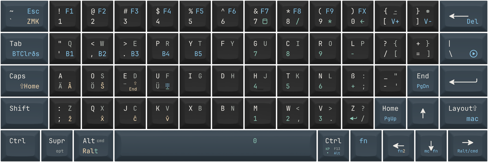

# Arnoll OrthoKB60 1

A non-QWERTY-friendly 100% orthorlinear keyboard
65 Key 60% ortholinear keyboard

## Layout and instruction

.: + `E`: ex. `A` + `E` = ä (Alt code for Windows, Option code in Mac Layer)  
+: `fn`: ex. `Home | +Pgup` means `fn` + `Home` = `Page up`  
/: `fn2`: ex: `Caps | /⇧Home` means `fn2` + `Caps` = "`Shift` + `Home`"  
`fn2` = `fn` + `Left`  
`[ | /F11 | + Vol-`: `[` = `[`, `fn` + `[` = Volume +, `fn2` + `[` = `F11`

Keys that the text is not black and in the same color next to each other act as the same key as the right key (left key + right key = right key)  
Ex. ] + Backspace = Backspace, End + Enter = Enter

Keypad layer (At fn+U): Other keys are transparent but LAlt becomes RAlt, so if wanted to RAlt + KP, just switch to keypad layer and type Alt + Keypad numbers.

## Development Stage

- [x] IO definition ([.overlay](./boards/shields/arnoll_orthokb60_1/arnoll_orthokb60_1.overlay))
  - Column: `&shifter` 0~15 (8 and 9 excluded) which `cs-gpio` is `&xiao_d 5`
  - Row: `&xiao_d` 4~0
- [x] RC() transform ([.overlay](./boards/shields/arnoll_orthokb60_1/arnoll_orthokb60_1.overlay))
- [x] physical layout and position_map layout ([.overlay](./boards/shields/arnoll_orthokb60_1/arnoll_orthokb60_1.overlay))
- [ ] Keymap
  - Layers
    - Main layer (&kp Q &kp W, ...)
    - Hardware Dvorak layer (&kp SQT &kp COMMA &kp DOT &kp P, ...)
    - Mac Main layer (* mac fn / &kp GLOBE)
    - fn layer
    - fn2 layer
    - Numpad layer
    - Leave custom layer 1~3
- [ ] AE, OE, UE, ES
- [ ] Caps, Number Lock, macLock indicator
- [ ] Leave Linux and cross-platform umlaut solution and 3 extra layers for ZMK customization
  - fn2 + L = Linux Layer?

## To experiment

https://zmk.dev/docs/keymaps/list-of-keycodes#editing